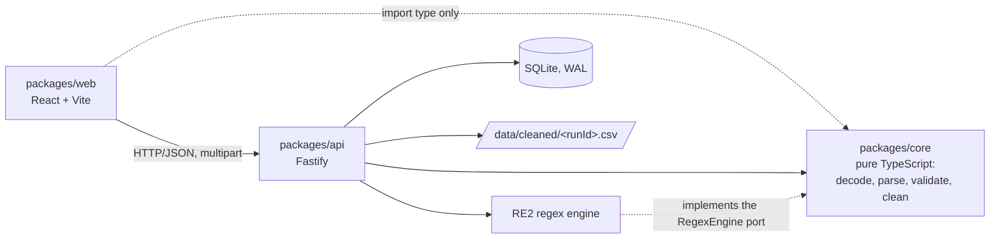

# CSV Validator & Cleaner

Define what a CSV should look like once, then validate and clean files against it as often as you like. Every run gets a precise error report (row, column, code, message), a cleaned CSV you can download, and a place in the history, so the fix is repeatable and auditable instead of a one-off Excel session.

- **Reusable schemas**: typed columns with `required`, `unique`, `pattern`, `min`/`max`, `enum` and date formats.
- **Fast**: a 10 MiB file validates and cleans in about 0.3 s on a laptop (see [Performance](#performance)).
- **Deterministic cleaning**: trimmed values, ISO dates, duplicate keys dropped, formula injection neutralised. Same input and schema always give the same bytes. No guessing, no "AI".
- **Nothing is lost**: columns that are not in the schema pass through untouched.
- **Audit trail**: each run keeps a snapshot of the schema it used, so old reports stay reproducible even after the schema changes or is deleted.

Out of scope for v1: accounts and multi-tenancy, `.xlsx` files, background jobs.

## Prerequisites

- **Node.js 22.13 or newer** (`.nvmrc` pins 22) and npm 10+.
- macOS or Linux. The two native dependencies (`re2` and `better-sqlite3`) install from prebuilt binaries; only macOS on Apple silicon has been verified so far.

## Install, build, run

```sh
npm install
npm run build      # builds core and the API with tsc, then the web app with Vite
npm start          # http://127.0.0.1:3001 (API and web app on one port)
```

For development, run the API (with reload) and the web app (Vite, hot reload) together:

```sh
npm run dev        # open http://localhost:5173
```

`npm run dev:api` and `npm run dev:web` run either one on its own.

### Configuration

All settings are environment variables; the defaults suit a single user on one machine.

| Variable        | Default                 | Meaning                                                                     |
| --------------- | ----------------------- | --------------------------------------------------------------------------- |
| `HOST`          | `127.0.0.1`             | Interface to listen on. The API has no login, so keep it on loopback.       |
| `PORT`          | `3001`                  | Port (0 picks a free one).                                                  |
| `DATA_DIR`      | `<repo>/data`           | SQLite database (`app.db`) and cleaned files (`cleaned/<runId>.csv`).       |
| `WEB_ORIGIN`    | `http://localhost:5173` | The one browser origin allowed by CORS (the Vite dev server).               |
| `WEB_DIST`      | `packages/web/dist`     | Built web app to serve; skipped if it is not built.                         |
| `ALLOWED_HOSTS` | (none)                  | Extra `Host` names to accept, comma separated, if you bind beyond loopback. |
| `LOG_LEVEL`     | `info`                  | Pino log level.                                                             |

## Using it

1. **Create a schema** under _Schemas_: name the columns, pick a type for each, and add rules.
2. **Validate** a file under _Validate_: pick the schema, drop in a CSV (up to 10 MiB) and submit.
3. **Read the report**: counts, per-error-type filters and the error table. Download the cleaned CSV, which contains only the valid rows.
4. **Come back later** via _History_. Runs stay until you delete them.

### Example

Schema (as JSON, the same shape the API takes):

```json
{
  "name": "Invoices",
  "columns": [
    { "name": "id", "type": "integer", "required": true, "unique": true },
    { "name": "issued", "type": "date", "dateFormat": "DD.MM.YYYY" },
    { "name": "currency", "type": "string", "enum": ["USD", "EUR"] }
  ]
}
```

Input (`;` is detected automatically; `notes` is not in the schema):

```csv
id;notes;issued;currency
 1 ; keep me ;01.03.2024;USD
2;=HYPERLINK("x");31.04.2024;EUR
1;dup;02.03.2024;USD
```

Cleaned output (row 2 has an impossible date and row 3 repeats id `1`, so both are reported and dropped):

```csv
id,notes,issued,currency
1, keep me ,2024-03-01,USD
```

### Schema reference

Column properties:

| Property     | Applies to                            | Meaning                                                                                                |
| ------------ | ------------------------------------- | ------------------------------------------------------------------------------------------------------ |
| `name`       | all                                   | Header name; matched exactly after trimming, case-sensitive.                                           |
| `type`       | all                                   | `string`, `integer`, `decimal`, `date`, `boolean`, `email`.                                            |
| `required`   | all                                   | An empty value is an error.                                                                            |
| `unique`     | all                                   | The first occurrence wins; later ones are `NOT_UNIQUE` and dropped.                                    |
| `pattern`    | string, email                         | RE2 regex that must match the **whole** value (no lookaround or backreferences).                       |
| `min`, `max` | integer, decimal, string, email, date | Inclusive. Numbers bound the value, text bounds the length, dates are `YYYY-MM-DD`.                    |
| `enum`       | string, integer, decimal              | Allowed values (case-sensitive for text).                                                              |
| `dateFormat` | date                                  | `YYYY-MM-DD` (default), `DD.MM.YYYY`, `DD/MM/YYYY`, `MM/DD/YYYY`. `YYYY-MM-DD` is always accepted too. |

Error codes in reports:

| Code                     | Meaning                                                   |
| ------------------------ | --------------------------------------------------------- |
| `FILE_TOO_LARGE`         | Over 10 MiB (rejected before parsing; no run is created). |
| `FILE_EMPTY`             | No bytes or no header row.                                |
| `PARSE_ERROR`            | Broken CSV quoting, such as an unterminated quote.        |
| `MISSING_COLUMN`         | A schema column is not in the header.                     |
| `DUPLICATE_COLUMN`       | A schema column appears twice in the header.              |
| `COLUMN_COUNT_MISMATCH`  | A row has a different number of fields than the header.   |
| `REQUIRED`               | Empty value in a required column.                         |
| `INVALID_TYPE`           | Not an integer, decimal, boolean or email as declared.    |
| `INVALID_DATE`           | Not a real date in the declared format (or ISO).          |
| `PATTERN_MISMATCH`       | Does not match `pattern`.                                 |
| `NOT_IN_ENUM`            | Not one of the allowed values.                            |
| `BELOW_MIN`, `ABOVE_MAX` | Outside `min`/`max`.                                      |
| `NOT_UNIQUE`             | Repeats an earlier value in a `unique` column.            |

The first five codes fail the whole file; the rest are per row. See [`docs/01-srs.md`](docs/01-srs.md) for the exact rules.

### What cleaning does

- Reads UTF-8 (with or without BOM), UTF-16 with a BOM, or falls back to windows-1251; picks `,` or `;` from the header. The cleaned file is always UTF-8, `,`-delimited, `\n` line endings, no BOM.
- Keeps **all** original columns in their original order. Schema columns are trimmed and dates become `YYYY-MM-DD`; other columns are written as they were.
- Keeps only rows that pass every rule, in their original order.
- Prefixes `'` to text cells that start with `=`, `+`, `-` or `@` so Excel never runs them as formulas. Integer and decimal columns are exempt, so `-7` stays `-7`.
- Reports at most 1000 errors per run but always counts them all exactly; the UI says so when a run is cut off.

## Architecture



| Package         | Role                                                                                                                                                                     |
| --------------- | ------------------------------------------------------------------------------------------------------------------------------------------------------------------------ |
| `packages/core` | All parsing, validation and cleaning. Pure functions, no I/O, no clock, no native modules; the regex engine is injected. Owns the schema definition (Zod) and its types. |
| `packages/api`  | Fastify server: uploads, SQLite persistence, cleaned-file storage, security checks, serves the built web app. Injects the RE2 engine.                                    |
| `packages/web`  | React single-page app. Contains no validation logic; it imports only _types_ from core.                                                                                  |

A validation request runs inline: read the upload into memory, snapshot the schema, run `processCsv`, write the cleaned file (temp file, fsync, rename), then commit the run and its errors in one SQLite transaction. If the commit fails the file is removed; a startup sweep removes any file left by a crash. The raw upload is never written to disk.

Why it is built this way, with the trade-offs, is in [`docs/02-design.md`](docs/02-design.md).

## API summary

All routes are under `/api` and speak JSON, except the upload (multipart) and the download (CSV). Errors share one shape: `{ "error": { "code", "message", "details?", "requestId" } }`.

| Method and path                                 | Purpose                                                                                                                                                      |
| ----------------------------------------------- | ------------------------------------------------------------------------------------------------------------------------------------------------------------ |
| `GET /health`                                   | Liveness.                                                                                                                                                    |
| `POST /schemas`, `GET /schemas`                 | Create (201, or 409 name taken, 422 invalid) and list schemas.                                                                                               |
| `GET`, `PUT`, `DELETE /schemas/:id`             | Read, replace and delete a schema. Deleting never touches past runs.                                                                                         |
| `POST /validations`                             | Multipart `file` + `schemaId`. Returns the run summary (201). File-level failures are runs with `status: "failed"`; only an oversize file is an error (413). |
| `GET /validations?limit&cursor`                 | History, newest first, keyset-paginated.                                                                                                                     |
| `GET /validations/:id`                          | Summary, schema snapshot and the first 100 errors.                                                                                                           |
| `GET /validations/:id/errors?offset&limit&code` | Page through (and filter) the stored errors.                                                                                                                 |
| `GET /validations/:id/cleaned`                  | Download the cleaned CSV (404 for failed runs).                                                                                                              |
| `DELETE /validations/:id`                       | Delete a run, its errors and its cleaned file.                                                                                                               |

```sh
curl -s -X POST http://127.0.0.1:3001/api/schemas -H 'content-type: application/json' -d @schema.json
curl -s -F schemaId=<schema-id> -F file=@invoices.csv http://127.0.0.1:3001/api/validations
curl -s http://127.0.0.1:3001/api/validations/<run-id>/cleaned -o cleaned.csv
```

## Security notes

The API has no authentication (a deliberate v1 non-goal), so it is built to be safe on a loopback port:

- Binds to `127.0.0.1` by default and warns if you change that.
- Rejects any request whose `Host` is not loopback (blocks DNS rebinding) and any write whose `Origin` is not the web app (blocks other web pages from driving it). CORS allows the web app's origin only, never `*`.
- Regexes run on RE2, which matches in linear time, so a hostile pattern cannot stall the server.
- Downloads are sent as attachments with `nosniff` and a sanitised filename; cleaned CSVs neutralise formulas.
- The SPA is served with a strict Content-Security-Policy. Logs contain ids, routes, status and timings, never cell values.

Anyone who can reach the port can read and change everything, so do not expose it to a network.

## Development

| Command                 | What it does                                                     |
| ----------------------- | ---------------------------------------------------------------- |
| `npm run typecheck`     | Strict TypeScript for every package and the scripts.             |
| `npm run lint`          | ESLint plus dependency-cruiser. Enforces the package boundaries. |
| `npm run format:check`  | Prettier check (`npm run format` fixes).                         |
| `npm test`              | All tests (core, API, web) with Vitest.                          |
| `npm run test:coverage` | Tests with the coverage threshold on `packages/core`.            |
| `npm run build`         | Build core and the API with `tsc`, then the web app with Vite.   |
| `npm run bench`         | 10 MiB benchmark: p95 time and peak memory (see below).          |
| `npm run smoke`         | End-to-end check of the built server over real HTTP.             |

Run `npm run build` before `npm run smoke`. Tests cover each rule, the pipeline against golden files, properties (determinism, cleaned output is a fixed point), the API with fault injection, and the pages with Testing Library.

### Performance

`npm run bench` generates 10 MiB files (a typical mix and an all-error worst case, 7 errors per row, about 965,000 errors), runs each 20 times and reports p95 time and peak RSS. On an Apple M1 (8 cores, 16 GiB, Node 22.13):

| Scenario (10 MiB)          | p50    | p95    | RSS, first request |
| -------------------------- | ------ | ------ | ------------------ |
| core, typical              | 238 ms | 252 ms | 271 MiB            |
| core, all-error            | 257 ms | 299 ms | 234 MiB            |
| full API upload, typical   | 267 ms | 309 ms | 299 MiB            |
| full API upload, all-error | 273 ms | 308 ms | 256 MiB            |

The budget is p95 under 5 s. Memory figures include Node and the `tsx` loader. With the default (large) V8 heap, RSS can drift to about 590 MiB across many runs because V8 delays garbage collection; `npm run bench -- --heap-mib 256` shows ordinary files then stay at or below about 335 MiB. Do not treat a heap cap as a safety net, though: a 10 MiB file of millions of tiny rows is a different shape (see Known limitations) and ends the server process when the heap is capped at 1 GiB or less. Details are in [`docs/03-validation-report.md`](docs/03-validation-report.md).

## Known limitations

- **Memory depends on the shape of the file, not only its size.** Ordinary files of 10 MiB need about 250 MiB, but a single-column file of about 5.2 million tiny rows peaks at roughly 1.85 GiB, and with a small V8 heap it aborts the whole server. There is no guard against this yet.
- **One server per data directory.** Two instances sharing `DATA_DIR` can delete each other's in-flight cleaned files at start-up; nothing prevents it.
- **Download file names are ASCII only.** Other characters become `_`, so `отчёт.csv` downloads as `_.cleaned.csv`.
- **One file at most 10 MiB, processed inline.** Validation blocks the server's event loop for the (short) duration of a run, so it suits one user, not many. Worker threads are the first v2 step.
- **No login.** Loopback only; see Security notes.
- **Encodings and delimiters.** UTF-8, UTF-16 with a BOM, else windows-1251; `,` or `;` only. A legacy file in another single-byte encoding will decode wrongly without an error, and so will a UTF-8 file with even one invalid byte (the whole file falls back to windows-1251). The detected encoding is shown on every run but not flagged as a warning, and there is no manual override yet.
- **Regex dialect is RE2.** No lookahead, lookbehind or backreferences; schemas using them are rejected on save.
- **Errors are capped at 1000 stored per run** (counts stay exact). There is no export of the full list.
- **Sanitising has side effects.** Text that begins with `=`, `+`, `-` or `@` gets a leading `'`, so phone numbers such as `+49 170…` change, and re-uploading a cleaned file can trip a strict `pattern`, `enum` or `max` length on such cells. Pass-through cells that begin with a tab or carriage return are not prefixed.
- **Unique is per column**, no composite keys. No per-column case normalisation. No `.xlsx`.
- **Runs and cleaned files are kept until you delete them**; there is no expiry and no disk-usage view.
- **A busy port stops the server from starting.** Nothing picks another port for you: set `PORT`. The dev web app proxies `/api` to port 3001, so with `npm run dev` that port must be free.
- **Verified on macOS (Apple silicon) only.** Linux and Windows have not been run, and there is no CI. The web app has been tested with component tests and a scripted HTTP check, but not audited for accessibility or exercised in a real browser.

## Documentation

| Document                                                       | What it is                                                       |
| -------------------------------------------------------------- | ---------------------------------------------------------------- |
| [`docs/00-problem.md`](docs/00-problem.md)                     | The problem, scope and open questions.                           |
| [`docs/01-srs.md`](docs/01-srs.md)                             | Requirements (FR, NFR) and acceptance criteria (AC).             |
| [`docs/02-design.md`](docs/02-design.md)                       | Architecture, schema, trade-offs and the implementation roadmap. |
| [`docs/03-validation-report.md`](docs/03-validation-report.md) | Every requirement traced to code and tests, deviations, debt.    |
| [`docs/04-ai-usage.md`](docs/04-ai-usage.md)                   | How the work was split between author and AI assistant.          |
| [`docs/05-retrospective.md`](docs/05-retrospective.md)         | What we learned and what comes next.                             |
