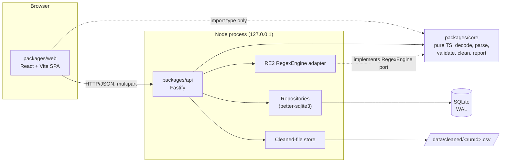
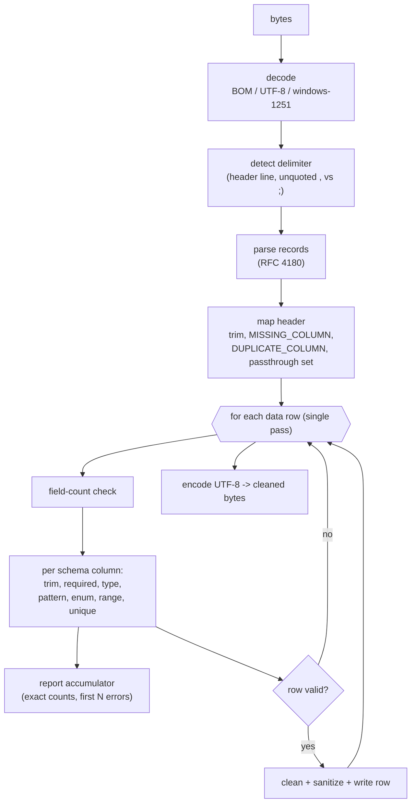

# 02 — System Design: CSV Validator & Cleaner

Status: Draft v0.1
Depends on: `00-problem.md`, `01-srs.md` (v0.3)

This document describes *how* the requirements in the SRS are met. Requirement IDs are cited as (FR-n / NFR-n / AC-n). Where the design clarifies or extends the SRS, it says so explicitly (§11).

## 1. Architecture Overview

A TypeScript npm-workspaces monorepo with three packages and one hard rule: **dependencies point inward to `core`**.



### 1.1 Dependency rules (enforced in CI, AC-39)

| Package | May import | Must not import |
|---|---|---|
| `core` | `zod`, `csv-parse` (pure JS) | `fastify`, `better-sqlite3`, `re2`, `react`, any `node:*` I/O module, any native module |
| `api` | `core`, `fastify`, `better-sqlite3`, `re2`, `node:*` | `web` |
| `web` | `core` via `import type` only, `react`, `vite` | `api`, any runtime import from `core` |

Enforcement: ESLint `no-restricted-imports` per package plus a `dependency-cruiser` check in `npm run lint`. TypeScript `verbatimModuleSyntax` and `importsNotUsedAsValues`-style settings make a non-type import from `core` in `web` a compile error.

### 1.2 Runtime shape

- One Node process serves the API and, in production, the built SPA (`@fastify/static`), so the SPA and API share an origin and CORS is a no-op in production. In development, Vite (`:5173`) proxies `/api` to Fastify (`:3001`); `WEB_ORIGIN` is set to the Vite origin for NFR-13.
- Validation runs **inline in the request handler** (decision D-5): parse, validate, clean, and persist happen before the response. There is no queue and no worker thread in v1.
- Configuration is environment-only: `HOST` (default `127.0.0.1`), `PORT`, `DATA_DIR` (default `./data`), `WEB_ORIGIN`.

## 2. Repository Layout

```
csv-validator/
├── package.json                  # workspaces: ["packages/*"], scripts: build/test/lint
├── tsconfig.base.json            # strict, ES2022, ESM, verbatimModuleSyntax
├── tsconfig.json                 # project references -> packages/*
├── vitest.workspace.ts
├── eslint.config.js              # boundary rules (§1.1)
├── .dependency-cruiser.cjs
├── .nvmrc                        # pinned Node LTS
├── docs/                         # 00-problem, 01-srs, 02-design
├── data/                         # runtime, git-ignored: app.db, cleaned/
└── packages/
    ├── core/
    │   ├── package.json
    │   ├── src/
    │   │   ├── index.ts            # public surface (§3.1)
    │   │   ├── schema/
    │   │   │   ├── definition.ts   # Zod schema + inferred types
    │   │   │   └── validate.ts     # validateSchemaDefinition(unknown, regex)
    │   │   ├── regex.ts            # RegexEngine port + error type
    │   │   ├── decode.ts           # encoding detection + decoding
    │   │   ├── delimiter.ts        # header-line delimiter detection
    │   │   ├── parse.ts            # CSV parsing behind an internal interface
    │   │   ├── rules/              # one file per type + pattern/enum/range
    │   │   │   ├── types.ts  date.ts  pattern.ts  range.ts  enum.ts
    │   │   ├── process.ts          # processCsv(): the single-pass pipeline
    │   │   ├── unique.ts           # first-occurrence tracker
    │   │   ├── clean.ts            # row writer, quoting, sanitization
    │   │   ├── report.ts           # accumulator: counts + capped errors
    │   │   └── errors.ts           # error code catalog (§4.3 of SRS)
    │   └── test/
    │       ├── fixtures/           # *.csv inputs + expected *.cleaned.csv / *.report.json
    │       └── *.test.ts
    ├── api/
    │   ├── package.json
    │   ├── src/
    │   │   ├── main.ts             # config -> buildApp() -> listen
    │   │   ├── app.ts              # buildApp(deps): Fastify instance, plugins, routes
    │   │   ├── config.ts
    │   │   ├── security.ts         # Host/Origin/CORS hooks, download headers (NFR-13)
    │   │   ├── errors.ts           # error envelope + handler
    │   │   ├── regex-re2.ts        # RE2-backed RegexEngine
    │   │   ├── db/
    │   │   │   ├── connection.ts   # open, pragmas, migrate
    │   │   │   ├── migrations/001_init.sql
    │   │   │   ├── schemas.repo.ts
    │   │   │   └── runs.repo.ts
    │   │   ├── storage/cleaned-files.ts  # write temp -> rename, delete, startup sweep
    │   │   ├── services/validation.service.ts   # orchestrates one validation
    │   │   └── routes/
    │   │       ├── schemas.routes.ts
    │   │       └── validations.routes.ts
    │   └── test/                   # fastify.inject + :memory: SQLite + temp DATA_DIR
    └── web/
        ├── package.json
        ├── vite.config.ts          # dev proxy /api -> :3001
        └── src/
            ├── main.tsx  App.tsx
            ├── api/client.ts       # typed fetch wrapper (types from core)
            ├── pages/              # Schemas, SchemaEditor, Validate, RunDetail, History
            └── components/         # ErrorTable, SummaryCards, ColumnRuleForm, ...
```

## 3. `packages/core`

### 3.1 Public surface

```ts
// Schema definition: Zod is the single source of truth (D-4)
export const SchemaDefinitionSchema: z.ZodType<SchemaDefinition>;
export type SchemaDefinition = z.infer<typeof SchemaDefinitionSchema>;
export type ColumnDefinition = SchemaDefinition['columns'][number];

// Regex port (D-3). The caller injects the engine.
export interface CompiledPattern { test(value: string): boolean }
export interface RegexEngine { compile(pattern: string): CompiledPattern } // throws RegexCompileError
export class RegexCompileError extends Error { readonly construct?: string }

// Validates shape + cross-field rules (min <= max, dateFormat only on date, pattern compiles, ...)
export function validateSchemaDefinition(
  input: unknown, regex: RegexEngine,
): { ok: true; schema: SchemaDefinition } | { ok: false; issues: SchemaIssue[] };

export interface ProcessInput {
  bytes: Uint8Array;
  schema: SchemaDefinition;       // already validated
  regex: RegexEngine;
  maxStoredErrors?: number;       // default 1000 (FR-26)
}

export type ProcessResult =
  | { status: 'completed'; report: RunReport; cleaned: Uint8Array }
  | { status: 'failed'; fileError: FileError; detectedEncoding?: string; detectedDelimiter?: string };

export function processCsv(input: ProcessInput): ProcessResult;
```

`processCsv` is a pure function of `(bytes, schema, regex)`. It reads no clock, generates no IDs, and touches no I/O (NFR-3, NFR-5). The caller assigns `id`, `createdAt`, filename, and hash.

`RunReport` carries exactly the FR-ER4 fields: counts, `errorCountsByCode`, `truncated`, capped `errors`, `passthroughColumns`, `detectedEncoding`, `detectedDelimiter`, `sanitizedCells`.

### 3.2 Pipeline



Key design points:

1. **Decode** (FR-9). Check for BOMs (UTF-16 LE/BE, UTF-8); otherwise try `new TextDecoder('utf-8', { fatal: true })`; on failure decode with `TextDecoder('windows-1251')`. These decoders ship with Node's full ICU build, so no dependency is needed. The encoding name is returned for the report. UTF-16 without a BOM is not supported (consistent with the SRS).
2. **Delimiter** (FR-10). A small scanner over the first logical line counts unquoted `,` and `;`. This runs before the parser because the parser needs the delimiter as an option.
3. **Parse** (FR-11, FR-13). The parser sits behind an internal `parseRecords(text, delimiter): string[][]` boundary so it can be replaced. v1 uses `csv-parse/sync` in relaxed-column-count mode so ragged rows reach our own field-count check instead of throwing. This choice is **provisional**: the first implementation increment starts with a fixture spike against AC-7 (quotes, embedded newlines, `\r`-only line endings, trailing blank line). If the spike fails, we replace it with a small hand-written RFC 4180 state machine behind the same boundary.
4. **Header mapping** (FR-12). Headers are trimmed, matched exactly against schema column names, and produce an index map. Pass-through columns are those not named in the schema. File-level errors short-circuit the pipeline.
5. **Compiled schema.** Before the row loop, each column is compiled once into a closure: `{ index, name, type, validators[], unique? }`. Regexes are compiled here via the injected `RegexEngine` as `^(?:…)$`, never per cell.
6. **Single pass.** Rows are validated and, if valid, appended to the output in the same loop. Total memory is the decoded text, the parsed records, the output chunks, and the unique-value maps, which is acceptable for ≤ 10 MiB (NFR-2). The error accumulator stops storing at the cap but keeps counting (FR-26, AC-41).
7. **Rule order per cell** exactly follows SRS §3.1. Note one consequence of that order together with FR-U4: a cell that fails `type` stops before `unique`, so it does **not** claim its key (an unparseable date has no normalized value to claim); a cell that fails only `pattern`, `enum`, or range **does** claim it.
8. **Unique tracking.** `Map<columnIndex, Map<normalizedValue, firstRowNumber>>`. Normalization is trimmed text, except `date` columns which use the canonical `YYYY-MM-DD` form so `01.03.2024` and `2024-03-01` collide (FR-U1). `duplicateRowsDropped` counts rows with at least one `NOT_UNIQUE` error.
9. **Cleaning** (FR-20, FR-21). Output columns follow the original header order; schema columns are written trimmed (dates canonical); pass-through columns are written as parsed. The sanitizer prefixes `'` per FR-21 and increments `sanitizedCells`. Quoting follows FR-20 item 6: quote only when a field contains `,`, `"`, `\r`, or `\n`; `"` is doubled. Line terminator is `\n`.
10. **Date handling** is implemented by explicit strict parsers per format (fixed-width digit checks plus a calendar-validity check using integer arithmetic), not `Date.parse`, so results do not depend on locale or timezone (NFR-3).

### 3.3 Determinism guardrails

- No `Date`, `Math.random`, `Intl`, or locale-sensitive functions in `core` (an ESLint rule bans them).
- Iteration orders come from arrays, never from object-key enumeration order of user input.
- `Map` iteration is never used for output ordering.
- A property test runs `processCsv` twice on generated inputs and asserts byte-equality (AC-26).

## 4. `packages/api`

### 4.1 HTTP surface

All routes are under `/api`. Bodies are JSON unless noted.

| Method & path | Purpose | Success | Notable errors |
|---|---|---|---|
| `POST /schemas` | Create schema | `201` schema | `422` invalid definition (issues list), `409` duplicate name |
| `GET /schemas` | List schemas | `200` array | |
| `GET /schemas/:id` | Get schema | `200` | `404` |
| `PUT /schemas/:id` | Replace schema | `200` | `404`, `409`, `422` |
| `DELETE /schemas/:id` | Delete schema (Runs unaffected) | `204` | `404` |
| `POST /validations` | Multipart: `file` + `schemaId`. Runs validation, persists a Run | `201` run summary | `404` unknown schema, `413` oversize, `400` malformed multipart |
| `GET /validations` | History, newest first, `?limit&cursor` | `200` page | |
| `GET /validations/:id` | Run summary + snapshot + first page of errors | `200` | `404` |
| `GET /validations/:id/errors` | `?offset&limit&code` | `200` page | `404` |
| `GET /validations/:id/cleaned` | Download cleaned CSV | `200 text/csv` | `404` (also for failed Runs, AC-35) |
| `DELETE /validations/:id` | Delete Run and its file | `204` | `404` |
| `GET /health` | Liveness | `200` | |

Conventions:

- **Error envelope:** `{ "error": { "code": "…", "message": "…", "details"?: …, "requestId": "…" } }` (NFR-12). Domain error codes from the SRS catalog appear inside run reports, not in this envelope; the envelope is for request-level failures.
- **A failed file-level validation is not an HTTP error.** `POST /validations` returns `201` with a Run whose `status` is `failed` and a `fileError`. Only `FILE_TOO_LARGE` is a transport error (`413`, no Run; see §11).
- **Validation of inputs.** Fastify's built-in Ajv validates only transport-level inputs: `:id` format, pagination parameters, multipart field presence. Schema definitions are validated by `core`'s Zod validator inside the handler (D-4), and failures map to `422` with the Zod issue paths.
- **Pagination.** History uses keyset pagination on `(created_at, id)`; error lists use `offset/limit` since they are capped at 1000.

### 4.2 Upload handling

- `@fastify/multipart` with `limits: { fileSize: 10 * 1024 * 1024, files: 1, fields: 4 }`. The stream is consumed into a single in-memory `Buffer`. When the limit trips (`file.truncated`), the handler aborts and returns `413` having never parsed the content (FR-7, NFR-8).
- The raw upload exists only as that buffer, so it is never written to disk and FR-DB4 / AC-33 hold by construction.
- `fileSha256` is computed over the buffer with `node:crypto`.
- `originalFilename` is stored as metadata only after stripping path components and control characters; it is never used as a filesystem path. Cleaned files are named by Run ID.

### 4.3 Validation orchestration (`validation.service.ts`)

```mermaid
sequenceDiagram
  autonumber
  participant W as Web SPA
  participant R as Route handler
  participant S as ValidationService
  participant C as core.processCsv
  participant F as CleanedFileStore
  participant D as SQLite (tx)

  W->>R: POST /api/validations (multipart: file, schemaId)
  R->>R: Host/Origin checks, stream into Buffer (<= 10 MiB)
  R->>S: validate(buffer, filename, schemaId)
  S->>D: load schema by id
  D-->>S: schema definition
  S->>S: sha256(buffer); re-validate definition (defensive)
  S->>C: processCsv({ bytes, schema, regex: RE2 })
  C-->>S: ProcessResult (report + cleaned bytes) or file error
  alt completed
    S->>F: write cleaned/<id>.csv.tmp, fsync, rename
  end
  S->>D: BEGIN; INSERT run (+ snapshot); INSERT run_errors; COMMIT
  alt DB failure
    S->>F: unlink cleaned file
    S-->>R: throw (500)
  end
  S-->>R: Run summary
  R-->>W: 201 { run }
```

Notes:

- The schema is read, snapshotted into the Run JSON, and used for processing from the same in-memory object, so the snapshot is exactly what was validated even if the schema is edited concurrently (FR-22, AC-3).
- Ordering for atomicity (FR-DB3): file first (temp then `rename`), DB commit second. A crash between the two leaves an orphaned file, never a Run pointing to a missing file. A **startup sweep** deletes any `cleaned/*.csv` whose ID has no Run row, and any `*.tmp` (AC-36).
- Single process, synchronous `better-sqlite3` calls: the `BEGIN…COMMIT` block runs without yielding to the event loop, so there are no interleaving hazards within one transaction.

### 4.4 Security hardening (NFR-8, NFR-9, NFR-13)

Implemented as Fastify `onRequest` hooks in `security.ts`:

1. **Host check:** `Host` must be in `{127.0.0.1:PORT, localhost:PORT}` (plus the configured host), else `403`. This defeats DNS-rebinding.
2. **Origin check:** for `POST/PUT/PATCH/DELETE`, if `Origin` is present it must equal `WEB_ORIGIN` (or the API's own origin when serving the SPA), else `403`. Requests without `Origin` (curl, tests) are allowed since a browser always sends it on cross-origin writes.
3. **CORS:** `@fastify/cors` with `origin: [WEB_ORIGIN]` only; credentials disabled; never `*`.
4. **Download headers:** `Content-Type: text/csv; charset=utf-8`, `Content-Disposition: attachment; filename="<sanitized>.cleaned.csv"`, `X-Content-Type-Options: nosniff`, `Cache-Control: no-store`.
5. **Logging:** Fastify's logger is configured with a serializer that records method, route pattern, status, duration, request ID, sizes, and counts. Request bodies and file content are never logged (NFR-9; a test asserts a known cell value is absent from log output, AC-43).
6. **Bind address:** `HOST` defaults to `127.0.0.1`; binding elsewhere requires an explicit env var and logs a warning that the API is unauthenticated.

### 4.5 RE2 adapter

```ts
// regex-re2.ts
import RE2 from 're2';
export const re2Engine: RegexEngine = {
  compile(pattern) {
    try {
      const re = new RE2(`^(?:${pattern})$`, 'u');
      return { test: (v) => re.test(v) };
    } catch (e) {
      throw new RegexCompileError(explain(e), detectConstruct(pattern, e));
    }
  },
};
```

`detectConstruct` maps RE2's parse errors (for example "invalid perl operator: (?!") to a friendly construct name ("lookahead", "lookbehind", "backreference") for FR-P2. Pattern length (≤ 500) is checked in `core`'s schema validation, independent of the engine. Core tests use a trivial `RegExp`-backed engine, so core tests never require the native module.

## 5. Persistence

### 5.1 Storage layout

```
DATA_DIR/
├── app.db               # SQLite, WAL (app.db-wal / app.db-shm alongside)
└── cleaned/
    └── <runId>.csv      # sanitized cleaned output (FR-DB6)
```

Connection pragmas: `journal_mode = WAL`, `foreign_keys = ON`, `synchronous = NORMAL`, `busy_timeout = 5000`.

### 5.2 DDL (`migrations/001_init.sql`)

```sql
CREATE TABLE schema_migrations (
  version     INTEGER PRIMARY KEY,
  applied_at  TEXT NOT NULL
);

CREATE TABLE schemas (
  id          TEXT PRIMARY KEY,                 -- UUID v4, assigned by api
  name        TEXT NOT NULL,
  name_key    TEXT NOT NULL UNIQUE,             -- lower(trim(name)); enforces FR-1 uniqueness
  definition  TEXT NOT NULL,                    -- JSON (SchemaDefinition)
  created_at  TEXT NOT NULL,                    -- ISO 8601 UTC
  updated_at  TEXT NOT NULL
);

CREATE TABLE runs (
  id                       TEXT PRIMARY KEY,    -- UUID v4, also the cleaned file name
  created_at               TEXT NOT NULL,       -- ISO 8601 UTC
  original_filename        TEXT NOT NULL,
  file_size_bytes          INTEGER NOT NULL,
  file_sha256              TEXT NOT NULL,

  -- Snapshot (FR-22). schema_id is informational: NO foreign key (FR-DB2).
  schema_id                TEXT,
  schema_name              TEXT NOT NULL,       -- denormalized for the history list
  schema_snapshot          TEXT NOT NULL,       -- JSON, full definition at run time

  status                   TEXT NOT NULL CHECK (status IN ('completed','failed')),
  file_error               TEXT,                -- JSON {code,message}, when failed
  detected_encoding        TEXT,
  detected_delimiter       TEXT,

  total_rows               INTEGER NOT NULL DEFAULT 0,
  valid_rows               INTEGER NOT NULL DEFAULT 0,
  invalid_rows             INTEGER NOT NULL DEFAULT 0,
  duplicate_rows_dropped   INTEGER NOT NULL DEFAULT 0,
  total_errors             INTEGER NOT NULL DEFAULT 0,
  truncated                INTEGER NOT NULL DEFAULT 0 CHECK (truncated IN (0,1)),
  error_counts_by_code     TEXT NOT NULL DEFAULT '{}',   -- JSON, exact (FR-26)
  passthrough_columns      TEXT NOT NULL DEFAULT '[]',   -- JSON array
  sanitized_cells          INTEGER NOT NULL DEFAULT 0,

  cleaned_path             TEXT,                -- relative to DATA_DIR, e.g. 'cleaned/<id>.csv'; NULL if none
  cleaned_size_bytes       INTEGER,

  CHECK (valid_rows + invalid_rows = total_rows)
);

CREATE INDEX idx_runs_created ON runs (created_at DESC, id DESC);

CREATE TABLE run_errors (
  run_id   TEXT    NOT NULL REFERENCES runs(id) ON DELETE CASCADE,
  seq      INTEGER NOT NULL,                    -- 0-based position in report order (FR-19)
  row      INTEGER NOT NULL,                    -- 1-based data row (SRS §1)
  column   TEXT,                                -- NULL for COLUMN_COUNT_MISMATCH
  code     TEXT    NOT NULL,
  message  TEXT    NOT NULL,
  value    TEXT,                                -- truncated to 200 chars (FR-ER2)
  PRIMARY KEY (run_id, seq)
) WITHOUT ROWID;

CREATE INDEX idx_run_errors_code ON run_errors (run_id, code, seq);
```

Design notes:

- **`run_errors` is a table, not a JSON column.** At ≤ 1000 rows per run the storage is bounded, and it makes pagination and `?code=` filtering plain SQL (D-9).
- **Counts are stored, not derived** (FR-26): `total_errors` and `error_counts_by_code` come from the accumulator, never from `COUNT(*)` over the capped table.
- **No FK from `runs` to `schemas`** so deleting a schema cannot touch history (AC-3). `schema_id` exists only so the UI can offer "re-run with the current version of this schema" when the schema still exists.
- The `CHECK` on row counts encodes the FR-ER5 invariant at the storage layer.
- `cleaned_path` is relative so the data directory can be moved. Deleting a Run deletes the row (errors cascade), then the file; if the file delete fails, it is retried by the startup sweep.

### 5.3 Repositories

`SchemasRepo` and `RunsRepo` are thin classes over prepared statements, constructed with a `Database` handle. They accept and return plain domain objects (types from `core` where applicable). Services depend on repository interfaces, so a future Postgres implementation (§9) is a substitution, not a rewrite.

## 6. `packages/web`

| Page | Responsibilities | Requirements |
|---|---|---|
| Schemas | List, create, delete | FR-2, FR-28 |
| Schema editor | Column builder: name, type, required, unique, pattern (with "RE2 syntax" hint), min/max, enum, dateFormat. Inline display of `422` issues by column/property | FR-3, FR-4, FR-P2 |
| Validate | Pick schema, drop file (client-side 10 MiB pre-check for UX only), submit, show result | FR-6, FR-28 |
| Run detail | Summary cards, per-code counts, paginated/filterable error table, truncation notice with the exact total, download button | FR-25, FR-29 |
| History | Paginated list: filename, schema name from snapshot, status, counts, time; delete action | FR-24, FR-27 |

Stack: React, React Router, TanStack Query for fetching and cache invalidation, plain CSS modules (no component library in v1). `src/api/client.ts` is a typed fetch wrapper whose request/response types are imported **as types** from `core` (no contract drift, D-4). The client holds **no validation logic** (FR-30); the 10 MiB pre-check only avoids a pointless upload and the server remains authoritative.

## 7. Testing Strategy

| Level | Scope | Tooling | Targets |
|---|---|---|---|
| Unit (core) | Each rule, date parser, delimiter/encoding detection, sanitizer, writer | Vitest | AC-10 to AC-25, coverage ≥ 90% (NFR-6) |
| Golden files (core) | `fixtures/*.csv` → expected cleaned CSV + report JSON, byte-compared | Vitest | AC-5 to AC-9, AC-19, AC-21a, AC-24 to AC-26 |
| Property (core) | Determinism; invariants `valid+invalid=total`, `Σcounts=total`, cleaned rows = valid rows; idempotence of cleaned output | Vitest + `fast-check` | AC-26, AC-27, AC-30 |
| Code coverage by code | Meta-test asserting each catalog code is produced by at least one fixture | Vitest | AC-42 |
| API integration | `fastify.inject`, `:memory:` SQLite, temp `DATA_DIR`, real RE2 | Vitest | AC-3, AC-32 to AC-37, AC-44 |
| Fault injection | Repository that throws mid-transaction; assert no partial Run and no orphan file | Vitest | AC-36 |
| Boundary lint | ESLint + dependency-cruiser in CI | npm script | AC-39 |
| Performance | Generated 10 MiB all-error and typical-mix files, 20 runs, report p95 | Node script (`npm run bench`) | AC-40, AC-41 |
| Web | Component tests for the schema editor and error table; one happy-path flow against a stubbed API | Vitest + Testing Library | AC-38 |

Test-data generation lives in `core/test/fixtures/gen/` so large files are generated, not committed.

## 8. Key Decisions & Trade-offs

| # | Decision | Alternatives considered | Rationale | Cost / risk accepted |
|---|---|---|---|---|
| D-1 | npm-workspaces monorepo, 3 packages, dependencies point to `core` | Single package; separate repos; pnpm/turborepo | Enforces the purity boundary physically; shared types with zero publishing overhead; npm needs no extra tooling | Some config overhead (project refs, lint rules) |
| D-2 | `core` is pure: bytes + schema + regex engine in, plain data out | Core with direct `fs`/DB access | Everything important is unit-testable without I/O; deterministic by construction (NFR-3, NFR-5) | Caller must assign IDs/times and persist |
| D-3 | **RE2 via an injected `RegexEngine` port** | Native `RegExp` + timeout guard; `RegExp` with a pattern allow-list; direct `re2` import in core | Linear-time matching removes ReDoS as a class (SRS no longer needs a guard); the port keeps `core` free of a native module and web-safe, and lets tests use a fake | RE2 dialect drops lookaround/backrefs (documented in FR-P1, rejected at save); one native dependency (`re2`) must install from prebuilt binaries |
| D-4 | **Zod in `core` as single source of truth** for schema shape; Fastify/Ajv for transport only | JSON Schema shared to Ajv; hand-duplicated types | One definition yields runtime validation and TS types for api and web; no drift | Zod bundle in core (small); Zod issues need mapping to our `422` format |
| D-5 | **Inline synchronous processing** in the request | Worker threads; job queue + polling | Simplest; no IPC/serialization of 10 MiB buffers; v1 is a single-user local tool and the NFR budget is ≤ 5 s | Event loop is blocked during a run; concurrent requests wait (NFR-1 notes this). Upgrade path in §9 |
| D-6 | SQLite via `better-sqlite3` (WAL) | Postgres; flat JSON files | Zero-ops, transactional, one file; synchronous API suits inline processing; sufficient for single-user history | Single writer; not suited to multi-instance deployment. Postgres swap via repository interfaces (§9) |
| D-7 | Fastify | Express; Hono; NestJS | Built-in schema/validation hooks, first-class TypeScript, lifecycle hooks suit the security checks, mature multipart plugin, faster than Express at equal ceremony | Smaller ecosystem than Express; plugin encapsulation model needs learning |
| D-8 | Cleaned CSVs on the filesystem, DB holds a relative path | SQLite BLOB | Avoids multi-MB blobs bloating the DB/WAL and slowing backups; downloads can stream from disk | Two stores to keep consistent: handled with write-then-rename, ordered commit, and a startup sweep (FR-DB3) |
| D-9 | Capped errors in a `run_errors` table, summary counts in `runs` | One JSON column on `runs` | Plain-SQL pagination and code filtering; bounded size anyway (≤ 1000 rows/run) | More rows to insert per run (batched in one transaction, negligible at 1000) |
| D-10 | Single in-memory pass over decoded text | Streaming parser | ≤ 10 MiB makes memory trivial; single pass gives exact counts and simple code | Not suitable for files ≫ 10 MiB; parser sits behind an interface (§9) |
| D-11 | Raw upload held only as an in-memory `Buffer` | Temp file on disk | Satisfies FR-DB4 by construction; nothing to clean up on failure | 10 MiB per concurrent request in RAM, bounded by the request limit |
| D-12 | `csv-parse` (provisional) behind `parseRecords()` | `papaparse`; hand-rolled parser | Mature RFC 4180 handling, pure JS, relaxed column counts | Needs a fixture spike against AC-7 first; hand-rolled fallback is small |
| D-13 | Encoding via `TextDecoder` (BOM → fatal UTF-8 → windows-1251) | `chardet` / `iconv-lite` | No dependency; matches SRS FR-9 exactly | windows-1251 fallback can mis-decode other legacy encodings; mitigated by recording the encoding (SRS decision 6) |
| D-14 | API serves the built SPA in production; dev uses a Vite proxy | Separate origins in production | Same origin makes CORS irrelevant in production and shrinks the NFR-13 attack surface | One more plugin (`@fastify/static`) |
| D-15 | Only `FILE_TOO_LARGE` is an HTTP error; other file-level failures become `failed` Runs | All file errors as 4xx | Failed attempts show up in history for audit; the report format stays uniform | Clients check `run.status`, not just the HTTP status |
| D-16 | UUID v4 run/schema IDs assigned in `api`; ordering by `created_at` + `id` | ULID/UUIDv7 | `crypto.randomUUID` needs no dependency; time ordering is explicit | IDs are not sortable by themselves |
| D-17 | No auth; compensate with loopback bind, Host/Origin checks, strict CORS | Shared secret / token | Non-goal for v1; browser-origin attacks are the real local threat and are covered cheaply | Anyone with local shell/network access to the loopback port has full access |

## 9. Scalability & Evolution Path

The design deliberately isolates the three things that would change first.

1. **Worker threads (the immediate v2 step; D-5).** `processCsv` is already a pure `bytes → result` function, so moving it off the event loop is mechanical:
   - run it in a `worker_threads` pool (for example `piscina`), transferring the upload `ArrayBuffer` zero-copy and returning `{ report, cleaned }`;
   - `ValidationService` becomes `await pool.run(...)`; routes and persistence are unchanged;
   - a native `re2` module loads fine inside workers, and the `RegexEngine` is constructed per worker;
   - optionally add `202 Accepted` + `GET /validations/:id` polling, with `status: 'running'` added to the `runs.status` CHECK. At that point the work is a job queue in all but name, and an external queue (BullMQ/Redis) becomes a candidate only if multiple processes are needed.
   Expected effect: the API stays responsive during a 3–5 s validation, at the cost of one copy of the result (cleaned bytes) crossing the thread boundary.
2. **Larger files.** Replace the in-memory `parseRecords` with a streaming parser and write the cleaned output to the file as it is produced. The error accumulator and unique maps are already incremental; the unique map (keys × rows) becomes the memory driver and could be bounded by hashing keys (with a collision-safe verification pass) or spilled to SQLite.
3. **Postgres / multi-instance.** Repository interfaces allow a Postgres implementation; cleaned files would move to object storage with the path column becoming a key. Auth and tenancy then enter scope (currently non-goals).
4. **Retention.** An opt-in TTL job or a "delete runs older than N days" action, plus showing `DATA_DIR` size in the UI, addresses unbounded growth (SRS decision 5).

## 10. Risks & Mitigations

| Risk | Impact | Mitigation |
|---|---|---|
| `re2` fails to install on a platform without a prebuilt binary | `npm install` friction (NFR-11) | Pin a version with prebuilds for macOS/Linux x64+arm64; CI matrix; documented fallback is to build from source |
| Users write patterns needing lookaround | Schema rejected | Clear error naming the construct (FR-P2); UI hint; most validation patterns are expressible in RE2 |
| `csv-parse` mishandles a RFC 4180 edge case | Wrong parse | Fixture spike first (D-12); parser behind an interface |
| windows-1251 fallback misdecodes another legacy encoding | Garbled values | Encoding recorded and displayed in the report; manual override is a v1.1 candidate |
| Inline processing blocks the event loop for several seconds | Sluggish UI under concurrent use | Acceptable for single-user v1; documented upgrade path (§9) |
| Orphaned cleaned files after a crash | Disk leak | Write-then-rename + ordered commit + startup sweep (AC-36) |
| Unbounded disk growth from retained cleaned files | Disk full over time | Surface size in UI; explicit delete; TTL candidate (§9) |
| Local API reached by hostile web page | Data read/write without auth | Host/Origin checks, strict CORS, `nosniff`/`attachment` (NFR-13, AC-44) |

## 11. Clarifications and Extensions to the SRS

Items where this design interprets or refines the SRS (all consistent with it; flagged for review):

1. **`FILE_TOO_LARGE` creates no Run** (FR-7, already clarified in SRS v0.3). Other file-level failures create `failed` Runs (D-15).
2. **A cell failing `type` does not claim its unique key**, while a cell failing only `pattern`/`enum`/range does (§3.2 point 7). This follows from SRS §3.1 ordering plus FR-U4 and should get a dedicated fixture (extending AC-20).
3. **`duplicateRowsDropped`** counts rows with ≥ 1 `NOT_UNIQUE` error, regardless of other errors on that row.
4. **Run `status` has two values in v1** (`completed`, `failed`); `running` is reserved for the v2 worker design.
5. **Errors are stored in a table** rather than a blob (D-9). The SRS only requires the cap and exact counts.
6. **Defensive re-validation** of the stored schema definition happens before each run, so a hand-edited database row cannot crash `core`.

## 12. Implementation Increments (preview)

Each increment is test-first and ends with a green `npm test`, a suggested Conventional Commit message, and no commits made by the assistant.

1. Workspace scaffolding: tsconfig, Vitest workspace, ESLint boundaries, dependency-cruiser, CI script.
2. `core`: schema definition (Zod) + `validateSchemaDefinition` + `RegexEngine` port.
3. `core`: decode + delimiter + parser spike (fixtures for AC-5 to AC-9).
4. `core`: rules (types, date, pattern, enum, range, required) with unit tests.
5. `core`: `processCsv` pipeline: unique, report accumulator, cleaner, sanitizer; golden and property tests.
6. `api`: config, security hooks, RE2 adapter, DB migrations, repositories.
7. `api`: schema routes, then validation routes with file store and atomic persistence.
8. `api`: history, errors, download, delete; fault-injection tests.
9. `web`: client + schema editor, then validate flow, report viewer, history.
10. Performance benchmark (AC-40, AC-41) and hardening pass.
